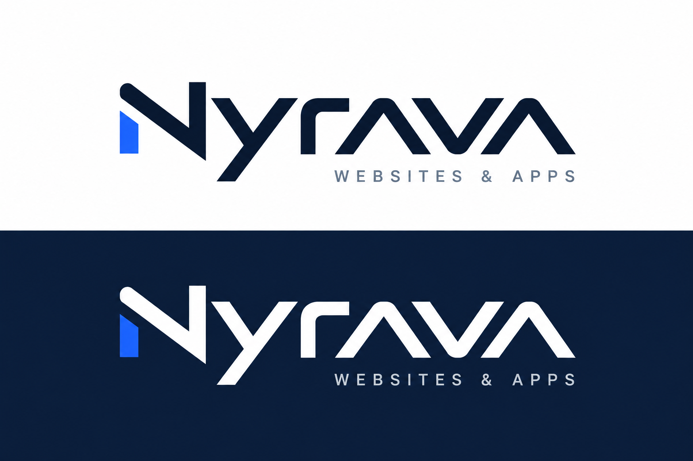

# Nyrava Websites & Apps

Websites, business applications, and reusable digital products. Built in Mexico.

This is our public product showcase. Application source code, deployment credentials, customer data, and development repositories are private. Products are available through a separate commercial agreement; this repository does not provide a free software license.

## Selected work

| Product | Focus | Availability |
| --- | --- | --- |
| Grupo CIP website | Bilingual Spanish/English website for electrical infrastructure, backup power, connectivity, and security services. | [View website](https://seba.nyrava.com/) · Client project |
| Nyrava Home | Application foundation for the Nyrava Home product family. | Development · Request a demonstration |
| Nyrava Mexico | Legal intelligence application development. | Development · Request a demonstration |

Product scope, delivery readiness, hosting, support, and pricing are confirmed in an individual proposal. A demonstration is not a grant of source-code rights.

## Work with us

We offer website development, application customization, and commercial product licensing. To request a proposal, open a public issue titled **Licensing inquiry** with a short, non-confidential description of your project. Do not post passwords, personal records, payment details, or confidential business information.

## Commercial licensing

- Access, permitted deployments, users, modification rights, support, and fees are specified in a signed agreement.
- Source access, resale, sublicensing, and white-label rights are included only when expressly agreed.
- Client branding and third-party components remain subject to their respective owners' rights and licenses.
- The [agreement template](COMMERCIAL-LICENSE-TEMPLATE.md) is a draft for completing and reviewing before a transaction. Browsing this showcase does not form a contract.

See [LICENSE.txt](LICENSE.txt) for the rights notice covering this showcase.
